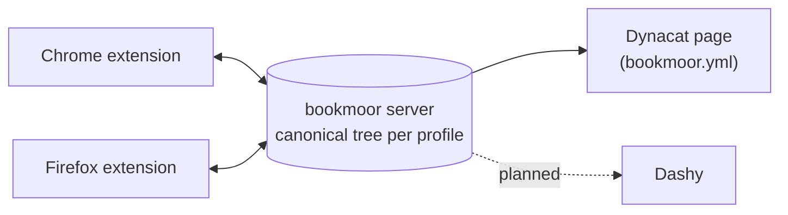

<p align="center">
  
</p>

<h1 align="center">bookmoor</h1>

<p align="center">
  <strong>Self-hosted bookmark sync. Your bookmarks, moored on your own server.</strong>
</p>

<p align="center">
  <a href="https://github.com/swallat/bookmoor/actions/workflows/ci.yml"></a>
  <a href="LICENSE"></a>
  
  
  
</p>

bookmoor syncs the **native bookmarks** of Chrome and Firefox through a server you
run yourself, and turns them into **dashboard pages for Dynacat**, straight from
the same tree. No third-party account, one small Rust binary, one JSON file.

> **Status: early alpha.** Sync engine, server and extension are covered by
> tests, including end-to-end tests with real Chromium and Firefox profiles
> against the real server, but have seen little manual use. Do not make
> bookmoor the only copy of anything important yet.

## Why bookmoor

Most tools in [awesome-selfhosted's Bookmarks and Link Sharing](https://awesome-selfhosted.net/tags/bookmarks-and-link-sharing.html)
list (linkding, Linkwarden, Karakeep, Shiori, Readeck, Shaarli, ...) are
separate bookmark *apps*: you save links into them and manage them there. bookmoor
is different: your **browser's own bookmark bar stays the source of truth**, and
bookmoor keeps every browser in step.

bookmoor does not replace those: they are for saving, tagging and archiving
links. bookmoor is for keeping the bookmarks you already have in your browsers
in sync, and for publishing them on a dashboard.

| | bookmoor | bookmark manager apps |
|---|---|---|
| Where you work | The browser's normal bookmark bar and manager | The tool's web UI or its own extension |
| Existing bookmarks | Synced as they are, folders and order included | Usually imported once |
| Chrome and Firefox together | One tree for both | Depends on the tool |
| Dashboard output | Dynacat page per profile, kept current | Not a goal |
| Server | One Rust binary, one JSON file, no database | Varies |

SyncMarks, also on that list, is the closest in purpose (browser bookmark sync).

### What sets it apart

- **Dashboards from your bookmarks.** Each profile (or a single folder of it)
  can be written as a Dynacat `bookmarks` widget file that is rewritten after
  every sync. Group titles, depth, icons and link flags are configurable, in
  the web UI or on the command line. See [docs/adapters/dynacat.md](docs/adapters/dynacat.md).
  A Dashy adapter is planned but **does not exist yet**.
- **Native, two-way browser sync.** A Chrome and a Firefox extension (MV3)
  sync the real bookmark tree. Firefox' bookmarks menu appears as a folder.
- **Several profiles per user.** Separate bookmark trees, for example Work and
  Private, each with its own devices and its own dashboard output.
- **Convergent and safe.** Concurrent edits merge per field with a three-way
  diff, edit beats delete, and fractional indexes keep reordering cheap. A
  device that was offline for days catches up with deltas. See
  [conflict resolution](docs/sync-architecture.md#4-conflict-resolution).
- **A careful first sync.** If the server and the browser both already hold
  bookmarks, the extension asks what to do instead of duplicating or
  overwriting. Matching bookmarks are recognised, not copied.
- **Modern sign-in and SSO.** Password, OpenID Connect, TOTP, passkeys
  (WebAuthn), and "Sign in with bookmoor" in the extension. Works behind
  Pangolin (including SSO sessions and client certificates), NetBird and
  Cloudflare Access, with extra headers and an mTLS check if you want them.
- **A web UI that manages, not just shows.** Browse and edit bookmarks, manage
  devices, tokens, users, single sign-on and Dynacat outputs. Favicons are
  optional.
- **Easy to run.** Multi-stage Docker image on GHCR, non-root, one volume,
  tagged releases (`latest`, `X.Y.Z`). Only token hashes are stored.

## How it works



Every browser is a peer. It reports what changed since its last sync, the server
merges that into the canonical tree, assigns stable ids and revisions, and hands
every other device only the delta. Details:
[docs/sync-architecture.md](docs/sync-architecture.md) and
[docs/architecture.md](docs/architecture.md).

## Quick start

With Docker (put a TLS reverse proxy in front, never publish the port directly):

```bash
cp docker-compose.example.yml docker-compose.yml
docker compose up -d
docker compose logs bookmoor | grep 'admin token'   # shown once on first start
```

From source (needs [mise](https://mise.jdx.dev)):

```bash
git clone https://github.com/swallat/bookmoor && cd bookmoor
mise install && mise run build
mise run server        # prints an admin token once, state in ./state.json
```

Then open the web UI, create the first admin with the admin token (CLI users and tokens: see [Users](docs/deployment.md#users)), install the
extension and press **Sign in with bookmoor** in its settings. Extension builds
come from the *Extension package* workflow and from releases; load Chrome's
`extension/dist` unpacked. Everything about proxies, SSO, users and tokens:
[docs/deployment.md](docs/deployment.md).

## Documentation

| Topic | Where |
|---|---|
| Docker, sign-in, OIDC, mTLS, Pangolin, NetBird, Cloudflare, users, tokens, web UI | [docs/deployment.md](docs/deployment.md) |
| Dynacat output | [docs/adapters/dynacat.md](docs/adapters/dynacat.md) |
| Building, Firefox signing, releases, Chrome Web Store | [docs/development.md](docs/development.md) |
| Sync design and conflict resolution | [docs/sync-architecture.md](docs/sync-architecture.md) |
| Multi-user model | [docs/multi-user.md](docs/multi-user.md) |

## Repository layout

| Path | Content |
|---|---|
| `crates/bookmoor-core` | Data model, diff and merge, Dynacat rendering (Rust) |
| `crates/bookmoor-server` | The server and web UI (Rust) |
| `extension/` | WebExtension in TypeScript (Chrome and Firefox) |
| `schema/` | JSON Schema generated from the Rust types |
| `docs/` | Architecture, ADRs, adapter notes |

## Open items

- Dynacat output is not yet tested against a long-running live Dynacat.
- Firefox sync is covered by CI, with little manual use so far.
- Dashy adapter and reading edits back from dashboards are planned.
- Not planned: end-to-end encryption, real-time push, reading list.

## Contributing

Issues and pull requests are welcome. Run `mise run check` before opening a PR;
it runs what CI runs. See [docs/development.md](docs/development.md).

## Privacy

bookmoor sends your bookmarks only to the server you configure and the developer
receives no data. Details: [PRIVACY.md](PRIVACY.md) ([Deutsch](PRIVACY.de.md)).

## License

Apache-2.0, see [LICENSE](LICENSE).
