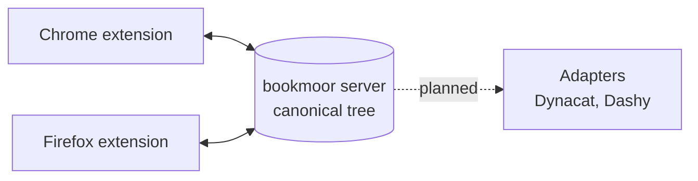

<p align="center">
  
</p>

<h1 align="center">bookmoor</h1>

<p align="center">
  <strong>Self-hosted bookmark sync. Your bookmarks, moored on your own server.</strong>
</p>

<p align="center">
  <a href="https://github.com/swallat/bookmoor/actions/workflows/ci.yml"></a>
  <a href="LICENSE"></a>
  
  
  
</p>

bookmoor keeps the bookmarks of all your browsers in one canonical tree on a
server you run yourself. No account with a third party, no cloud, one small
binary and one JSON file.

> **Status: early alpha (v0.0).** The sync engine, the server and the
> extension work and are covered by tests, including end-to-end tests against
> the real server binary. CI also runs the real extension in two real
> Chromium (and Firefox) profiles against the real server, but it has seen
> little manual use yet. Expect rough edges and
> do not make bookmoor your only copy of anything important yet.

## Why bookmoor

- **Yours.** The server stores everything in a single JSON file you can back
  up with `cp`. Only token hashes are stored, never the tokens.
- **Convergent.** Several devices edit concurrently and end up with the same
  tree. Changes merge per field with a three-way diff, so a rename on one
  laptop and a new URL on another both survive.
- **Safe by design.** Edit beats delete and moved nodes are never silently
  deleted. Keeping overwritten values for recovery is part of the design but
  not implemented yet. See
  [conflict resolution](docs/sync-architecture.md#4-conflict-resolution).
- **Offline-tolerant.** A device that was away for days catches up with
  deltas when it reconnects, and survives MV3 service-worker restarts.
- **Proxy-friendly.** Run it behind your reverse proxy. The extension can send
  extra headers (for example Pangolin header auth) and the server supports a
  path prefix. On top of that sit per-device API tokens with scopes and a
  rate limit.

## How it works



Every endpoint is a peer. The extension reports what changed since the last
sync, the server merges it into the canonical tree, assigns stable ids and
revisions, and hands every other device only the delta. Positions use
fractional indexes, so reordering never rewrites siblings.

Details: [docs/sync-architecture.md](docs/sync-architecture.md) and
[docs/architecture.md](docs/architecture.md).

## What works today

| Area | State |
|---|---|
| Core: data model, three-way diff and merge, fractional positions | Done, tested |
| Server: HTTP API, JSON snapshot persistence, device tokens, rate limit | Done, tested |
| Server: users (tree per user) and web UI for devices and users | Done, tested, see [docs/multi-user.md](docs/multi-user.md) |
| Chrome extension: delta sync, id map, echo suppression | Done, tested against a fake API and the real server |
| Firefox: root folder mapping, manifest (`extension/dist-firefox`) | Done, untested in a real Firefox |
| Real-browser E2E (two Chromium / Firefox profiles, `npm run test:e2e`) | Done, in CI |
| Multi-instance service-worker lease | Open |
| Dynacat adapter, push only (`--dynacat-file`) | Done, untested against a live Dynacat, see [docs/adapters/dynacat.md](docs/adapters/dynacat.md) |
| Dashy adapter | Planned, requirements in [docs/adapters](docs/adapters) |

## Quick start

You need [mise](https://mise.jdx.dev) (or Rust and Node by hand).

```bash
git clone https://github.com/swallat/bookmoor && cd bookmoor
mise install
mise run build
mise run server        # prints an admin token once, state in ./state.json
```

Then load `extension/dist` via `chrome://extensions` > Developer mode > Load
unpacked, and enter the server URL and a device token in the extension
options. Create device tokens as described under [Tokens](#tokens).

## Docker

A multi-stage image is published to `ghcr.io/swallat/bookmoor` (`edge` follows
`main`; release tags `vX.Y.Z` give `latest`, `X.Y.Z` and `X.Y`; pre-releases do not move `latest`). It runs as a
non-root user, keeps its state in the volume `/data` (`/data/state.json`) and
listens on `0.0.0.0:8787` with `--insecure-http`, because the server refuses a
non-loopback address without TLS in front. **Always put a reverse proxy with
TLS in front of it** and do not publish the port directly.

```bash
cp docker-compose.example.yml docker-compose.yml
docker compose up -d
docker compose logs bookmoor | grep 'admin token'   # shown once on first start; or set BOOKMOOR_ADMIN_TOKEN
```

Commands run in the same image, with the server stopped:

```bash
docker compose stop bookmoor
docker compose run --rm -T bookmoor token create --name laptop --scope sync --user anna --yes
echo 'a long password' | docker compose run --rm -T bookmoor user create --name anna --admin
docker compose start bookmoor
```

For the Dynacat adapter, mount a writable directory (uid 10001) and point
`BOOKMOOR_DYNACAT_OUTPUTS` at files in it (one `file=PATH[;profile=NAME][;folder=A/B/C]`
per line, see [docs/adapters/dynacat.md](docs/adapters/dynacat.md)); mount the same
directory into Dynacat. The example compose file shows both. Build locally with
`docker build -t bookmoor .`. If a command overrides `--bind` with another port, the
image's healthcheck (port 8787) reports unhealthy.

## Signing the extension in

Instead of pasting a token, press "Sign in with bookmoor" in the extension
settings (server URL first). The browser opens the server's page in an auth
window: sign in to the web UI (and to a proxy login in front of it, if any),
pick the device name and profile, and confirm. The server creates a **new**
`sync` token for that device on every sign-in (revoke old ones on the Devices
tab) and returns it in the URL fragment of the extension's redirect address,
so it reaches no log. The server only redirects to extension addresses
(`*.chromiumapp.org`, `*.extensions.allizom.org`). The extension needs the
`identity` permission for this; pasting a token still works.

## Single sign-on (OIDC)

The web UI can sign users in through any OpenID Connect provider (Authentik,
Keycloak, Authelia, Pocket ID, Google, ...), with the authorization code flow
and PKCE. Register the redirect URL `<public URL>/ui/api/oidc/callback` with
the provider, then start the server with:

```bash
BOOKMOOR_PUBLIC_URL=https://bookmoor.example.com   # where users reach the web UI
BOOKMOOR_OIDC_ISSUER=https://id.example.com/application/o/bookmoor/
BOOKMOOR_OIDC_CLIENT_ID=bookmoor
BOOKMOOR_OIDC_CLIENT_SECRET=...                    # optional for public clients
BOOKMOOR_OIDC_LABEL="Authentik"                    # button text (default "single sign-on")
BOOKMOOR_OIDC_CREATE_USERS=1                       # optional, see below
```

(or `--public-url`, `--oidc-issuer`, `--oidc-client-id`, `--oidc-label`,
`--oidc-create-users`; the secret is only read from the environment.) The
provider is contacted on first use, so the server starts while it is down.
Provider certificates are checked against the built-in public roots.

**Or in the web UI:** admins can set the same things up on the "Single sign-on"
tab (issuer, client ID and secret, public address, button text, whether to
create users), test the connection, and copy the redirect URL for the
provider. Changes apply at once, no restart. The client secret is saved in the
state file (readable by the server's user only) and never shown again; leave
the field empty to keep it. If the environment variables or flags above are
set, they win: the tab then shows them read-only, and settings saved earlier
are kept but unused until the variables are removed.

- **Linking:** a user signs in with the password once and presses "Link ..."
  under Account. From then on the provider's stable user id (`sub`) signs them in,
  never the name. Unlinking needs a password, so nobody locks themselves out.
- **Creating users:** with `--oidc-create-users` an unknown identity gets a new
  non-admin user on first sign-in (name from `preferred_username` or the email
  prefix, made unique). Without it, an unlinked identity is refused. Anyone who
  can sign in at the provider can create a user, so restrict the application
  there.
- **First admin:** unchanged, the setup form with the admin token; link single
  sign-on to that admin afterwards.
- With the same provider in front of the web UI (Pangolin, NetBird and
  Cloudflare Access can use OIDC providers) the second sign-in runs without
  typing anything. The extension's "Sign in with bookmoor" works with it too.

## Client certificates (mTLS)

Optionally the server can require a client certificate in addition to the
token. TLS ends at your reverse proxy, so the proxy checks the certificate
against your client CA and tells the server the result in a header. With
`--client-cert-header NAME[=VALUE]` (or `BOOKMOOR_CLIENT_CERT_HEADER`) every request
except `/health` must carry that header with the expected value, otherwise it
gets 403 before the token is looked at. `NAME` alone expects `SUCCESS`;
`NAME=*` accepts any value except empty, `NONE`, `0` and `FAILED...` (for proxies that set the header only for a
verified certificate).

nginx:

```nginx
ssl_client_certificate /etc/nginx/client-ca.pem;
ssl_verify_client optional;
location / {
    proxy_set_header X-SSL-Client-Verify $ssl_client_verify;  # always overwritten
    proxy_pass http://bookmoor:8787;
}
```

```bash
bookmoor-server --client-cert-header X-SSL-Client-Verify
```

The proxy must set the header on every request (so a client cannot send it
itself) and the server port must not be reachable around the proxy. Browsers
and the extension present the certificate from the browser or OS certificate
store, so install it there; Chrome asks once which certificate to use.

### Pangolin

Pangolin can use a client certificate as the only login of a resource: enable
"Client Certificate (mTLS)" on the Bookmoor resource, upload your CA, and turn
the other methods (SSO, PIN) off. The extension then reaches Bookmoor without a
Pangolin login; the Bookmoor token stays required. Pangolin checks the
certificate in the TLS handshake and forwards its details in
`X-Forwarded-Tls-Client-Cert-Info`, so this also works as the extra check above:

```bash
BOOKMOOR_CLIENT_CERT_HEADER='X-Forwarded-Tls-Client-Cert-Info=*'
```

Install the client certificate (PKCS#12) in the browser or OS store. If the
extension's requests fail with a TLS error because no certificate prompt
appears for background requests, select the certificate automatically (Chrome:
the `AutoSelectCertificateForUrls` policy; Firefox: "Select one automatically"
under Settings > Privacy & Security > Certificates). Not tested in a real browser.

### Pangolin SSO (browser login)

Instead of a certificate you can keep Pangolin's normal login (Platform SSO or
your OIDC provider) in front of Bookmoor, without shareable links. In the
extension settings, turn on "Server is behind a login page". Sign in once to
the Bookmoor URL in a browser tab; Pangolin sets its resource-session cookie
(30 days by default), and the extension sends it with every request. The
Bookmoor token stays required.

When the session ends (expiry, logout, revocation by the identity provider),
the sync stops with "Sign in again", the toolbar icon shows a `!`, and the
popup and settings offer a **Sign in** button. It opens the server URL in a new
tab; closing that tab after the login makes the extension sync again. Changes
made meanwhile stay queued locally. Not tested in a real browser yet (cookie
handling for extension requests differs between Chrome and Firefox).

### NetBird

NetBird's reverse proxy has no client-certificate authentication. Options, best first:

- **NetBird-Only access:** the extension's device is a NetBird peer, so there is
  no login at all. Needs a self-run proxy cluster (see NetBird's docs).
- **Header authentication with a custom header:** create a header entry such as
  `X-Proxy-Key` on the service and add the same name and value under "Extra
  headers" in the extension. Do not use the `Authorization` presets: the proxy
  strips the matching header, so the Bookmoor token would never arrive.
- **SSO:** turn on "Server is behind a login page" (see Pangolin SSO above).
  NetBird sessions last 24 hours, so expect a sign-in about once a day.

### Cloudflare Tunnel with Cloudflare Access

Put a Cloudflare Access application in front of the tunnel hostname.

- **Service token:** create a service token with a policy of action "Service
  Auth" and add `CF-Access-Client-Id` and `CF-Access-Client-Secret` under
  "Extra headers". No browser login, and it works with the extension as it is.
- **Browser login:** with an Allow policy and your identity provider, turn on
  "Server is behind a login page". Cloudflare answers with a redirect to its
  login, which the extension reports as "Sign in again"; the session length is
  set on the Access application. Not tested in a real browser; Cloudflare's
  cookie is sent to the app domain, so browsers that block third-party cookies
  may need an exception.

In both cases the Bookmoor token stays required.

## Layout

| Path | Content |
|---|---|
| `crates/bookmoor-core` | Data model, adapter trait, identity strategies, diff and merge (Rust) |
| `crates/bookmoor-server` | The self-hosted server (Rust) |
| `extension/` | WebExtension in TypeScript (Chrome first) |
| `schema/` | JSON Schema generated from the Rust types |
| `docs/` | Architecture, ADRs, per-adapter requirements analyses |

## Roadmap

- **v0.1** Chrome extension against a real browser, hardening, first release.
- **v0.2** Dynacat adapter, conflict strategies per endpoint.
- **v0.3** Firefox, Dashy, a generic exec adapter.

Not planned for v0.1: multi-user tenancy, end-to-end encryption, real-time
push, and browser-specific fields such as favicons or the reading list.

## Development

Tools and build commands run through [mise](https://mise.jdx.dev):

```bash
mise install          # Rust and Node
mise run build        # server (target/release), extension/dist (Chrome), extension/dist-firefox
mise run check        # what CI checks
mise run server       # start the server, state in ./state.json
mise tasks            # all tasks
```

Without mise: `cargo test`, and `cd extension && npm ci && npm run build`.
Chrome: load `extension/dist` via `chrome://extensions` > Developer mode > Load
unpacked. Firefox: `about:debugging` > This Firefox > Load Temporary Add-on,
then pick `extension/dist-firefox/manifest.json` (gone after a restart).

### Download a built extension

Every change to the extension on `main` runs the "Extension package" workflow
(Actions tab > latest run > Artifacts): a Chrome zip (unzip it and load the
folder unpacked), an unsigned Firefox zip and, once the repository secrets
`WEB_EXT_API_KEY` and `WEB_EXT_API_SECRET` are set, a signed Firefox `.xpi`
that stays installed across restarts. The version is `0.<run>.<attempt>`.

### Firefox: keep the extension after a restart

A temporarily loaded add-on is gone after a restart. For a permanent install
have Mozilla sign it (free, "unlisted", nothing is published):

1. Create API credentials at <https://addons.mozilla.org/developers/addon/api/key/>
   (JWT issuer and JWT secret). Treat them like a password.
2. Put them into the environment of your shell, not into the repo:
   `WEB_EXT_API_KEY` (issuer) and `WEB_EXT_API_SECRET` (secret).
3. `mise run sign:firefox`. The signed `.xpi` lands in
   `extension/web-ext-artifacts/`. Install it via `about:addons` > gear icon >
   Install Add-on From File.

Each signing needs a new `version` in `extension/manifest.json`. Without
signing, only Firefox Developer Edition, Nightly and ESR can install an
unsigned file (set `xpinstall.signatures.required` to `false`):
`mise run package:firefox` builds the unsigned `.zip`, rename it to `.xpi`.

### Releases and versions

Server, core and extension share one release number `X.Y.Z`. Its single source
is `[workspace.package] version` in `Cargo.toml`; `extension/package.json`,
`package-lock.json` and `manifest.json` are copies that
`node scripts/sync-version.mjs` writes (CI fails if they drift). To release:

1. `node scripts/sync-version.mjs --set 0.11.0 && cargo update --workspace`, open a PR, merge it.
2. Publish a GitHub release with the tag `v0.11.0` on that commit. The workflows refuse a tag that differs from `Cargo.toml`.
3. The release builds the Chrome zip and the signed Firefox `.xpi` with exactly `0.11.0`, submits Chrome to the Web Store and pushes the Docker image as `0.11.0`, `0.11` and `latest`.

The script refuses any version not above `0.9.1`, the highest number CI signed before releases were coordinated (Mozilla and the stores never accept a lower one). The first release is therefore `0.10.0` (already set in `Cargo.toml`).

Builds from `main` and manual runs are dev builds numbered `X.Y.Z.<run>` (browsers allow at most four parts); they sort after `X.Y.Z`, so they are signed only while the tag `vX.Y.Z` exists. Between a version bump and its release tag they are built but not signed. Only plain `X.Y.Z` tags are supported (no `-rc` suffixes, browsers reject them).

### Chrome Web Store (unlisted, uploaded by CI)

Chrome only installs extensions from the Web Store (or by policy), so the Chrome equivalent of a signed `.xpi` is an **unlisted** store item: nobody finds it by search, you install it with its link and it updates itself. The `Extension package` workflow uploads every build and submits it for review once these four repository secrets are set (Settings > Secrets and variables > Actions):

| Secret | Where it comes from |
| --- | --- |
| `CWS_EXTENSION_ID` | the item's ID from the Web Store developer dashboard (step 1) |
| `CWS_CLIENT_ID`, `CWS_CLIENT_SECRET` | an OAuth client (step 2) |
| `CWS_REFRESH_TOKEN` | a refresh token for your Google account (step 3) |

1. **Create the item once, by hand.** In the [developer dashboard](https://chrome.google.com/webstore/devconsole) choose *New item* and upload `bookmoor-chrome-<version>.zip` from a workflow run. Fill in the listing (description, a screenshot, category), the privacy tab (it reads bookmarks and talks to your own server; no data goes to the developer) and under *Distribution* set visibility to **Unlisted**. Submit it. The ID (32 letters) is in the item's URL.
2. **OAuth client.** In the [Google Cloud console](https://console.cloud.google.com/) create a project, enable the *Chrome Web Store API*, set up the OAuth consent screen (external, add yourself as test user, then *publish app* so the refresh token does not expire after 7 days) and create an OAuth client ID of type *Desktop app*.
3. **Refresh token.** Open `https://accounts.google.com/o/oauth2/auth?response_type=code&scope=https://www.googleapis.com/auth/chromewebstore&redirect_uri=http://localhost&client_id=<CLIENT_ID>&access_type=offline&prompt=consent`, allow access and copy the `code` parameter from the (failing) `localhost` redirect URL. Then run `curl -s https://oauth2.googleapis.com/token -d client_id=<CLIENT_ID> -d client_secret=<CLIENT_SECRET> -d code=<CODE> -d grant_type=authorization_code -d redirect_uri=http://localhost` and use the `refresh_token` from the answer.

The store upload is not part of every build: it runs when you **publish a GitHub release**, or when you start the `Extension package` workflow by hand (Actions > Run workflow) with *Also upload the Chrome build to the Web Store* ticked. It uploads a new version (`0.<run>.<attempt>`) and submits it. Ordinary pushes to `main` only produce the downloadable artifacts. Review usually takes a few hours to days; the previous version stays live meanwhile. The store keeps one pending submission at a time, so a second upload while one is in review fails the upload step (the zip is still an artifact).

### Log

The server writes one line per request to stderr: time (UTC), client address,
token name (`-` if unauthenticated), method, path, status and duration. Query
strings are left out because proxy setups may carry secrets there; `/health`
is not logged. Behind a reverse proxy the address is the proxy's.

### Web UI

The server serves a small admin page at `/` (behind your reverse proxy at the
same path prefix; links are relative). Sign in with a user name and password to
create and revoke device tokens (the token is shown once), change your password
and, as an admin, add, promote and remove users. On a fresh install the page
asks for the admin token once to create the first admin; after an upgrade use
the name `owner` there to keep your bookmarks. Sessions last 7 days and live in
memory, so a restart signs everyone out. The session cookie is `HttpOnly`,
`SameSite=Strict` and `Secure` unless `--insecure-http` is set; pages are
served with a strict Content-Security-Policy and no external resources.

### Users

Every user has their own bookmark tree; devices and tokens belong to a user
(see [docs/multi-user.md](docs/multi-user.md)). Older single-user state files
become the user `owner`. A fresh install has no user: start the server once (it creates the state file
and prints the admin token), stop it, and run `user create` before the first
`token create`; or create the user with the admin token while it runs. Users are managed with an admin token
(`POST /v1/users`, `GET /v1/users`, `DELETE /v1/users/{id}`) or, with the
server stopped:

```bash
echo 'a long password' | bookmoor-server user create --name anna --admin --state state.json
echo 'a long password' | bookmoor-server user passwd --name anna --state state.json
```

### Tokens

The extension needs a **device token** (scope `sync`), one per browser. The
admin token only manages tokens and has no device, so the server answers 403
when it is used for syncing. The extension options show the last sync status.

The first start with a new state file prints an admin token once. Only a hash
is stored, so a lost token cannot be shown again. Device tokens come from
`POST /v1/tokens` (admin token required) or, with the server stopped, from the
command line:

```bash
mise run token:create -- --name laptop --scope sync --user anna --profile Work
# or: bookmoor-server token create --name laptop --scope sync --state state.json
```

The command refuses to run while a server holds the state file (an OS lock on
`state.json.lock`, released by the system even after a crash; the empty file
itself may stay), asks you to retype the name unless you pass `--yes`, and
needs `--allow-admin` for an admin token. The token is printed once. To
replace a lost admin token, start the server with `BOOKMOOR_ADMIN_TOKEN` set to
a new `bkm_<id>_<64 hex characters>`, or use the command above with
`--scope admin --allow-admin`.

## Contributing

Issues and pull requests are welcome. Run `mise run check` before opening a PR;
it runs what CI runs.

## Privacy

bookmoor sends your bookmarks only to the server you configure and the developer receives no data. Details: [PRIVACY.md](PRIVACY.md) ([Deutsch](PRIVACY.de.md)).

## License

Apache-2.0, see [LICENSE](LICENSE). Do not copy code from Glance/Dynacat
(AGPL-3.0, to be verified); adapters must only use their files and APIs.
