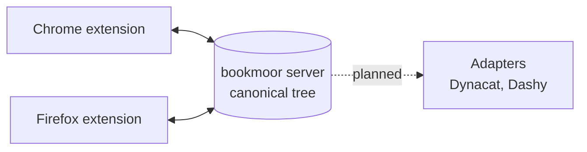

<p align="center">
  
</p>

<h1 align="center">bookmoor</h1>

<p align="center">
  <strong>Self-hosted bookmark sync. Your bookmarks, moored on your own server.</strong>
</p>

<p align="center">
  <a href="https://github.com/swallat/bookmoor/actions/workflows/ci.yml"></a>
  <a href="LICENSE"></a>
  
  
  
</p>

bookmoor keeps the bookmarks of all your browsers in one canonical tree on a
server you run yourself. No account with a third party, no cloud, one small
binary and one JSON file.

> **Status: early alpha (v0.0).** The sync engine, the server and the
> extension work and are covered by tests, including end-to-end tests against
> the real server binary. CI also runs the real extension in two real
> Chromium (and Firefox) profiles against the real server, but it has seen
> little manual use yet. Expect rough edges and
> do not make bookmoor your only copy of anything important yet.

## Why bookmoor

- **Yours.** The server stores everything in a single JSON file you can back
  up with `cp`. Only token hashes are stored, never the tokens.
- **Convergent.** Several devices edit concurrently and end up with the same
  tree. Changes merge per field with a three-way diff, so a rename on one
  laptop and a new URL on another both survive.
- **Safe by design.** Edit beats delete and moved nodes are never silently
  deleted. Keeping overwritten values for recovery is part of the design but
  not implemented yet. See
  [conflict resolution](docs/sync-architecture.md#4-conflict-resolution).
- **Offline-tolerant.** A device that was away for days catches up with
  deltas when it reconnects, and survives MV3 service-worker restarts.
- **Proxy-friendly.** Run it behind your reverse proxy. The extension can send
  extra headers (for example Pangolin header auth) and the server supports a
  path prefix. On top of that sit per-device API tokens with scopes and a
  rate limit.

## How it works



Every endpoint is a peer. The extension reports what changed since the last
sync, the server merges it into the canonical tree, assigns stable ids and
revisions, and hands every other device only the delta. Positions use
fractional indexes, so reordering never rewrites siblings.

Details: [docs/sync-architecture.md](docs/sync-architecture.md) and
[docs/architecture.md](docs/architecture.md).

## What works today

| Area | State |
|---|---|
| Core: data model, three-way diff and merge, fractional positions | Done, tested |
| Server: HTTP API, JSON snapshot persistence, device tokens, rate limit | Done, tested |
| Chrome extension: delta sync, id map, echo suppression | Done, tested against a fake API and the real server |
| Firefox: root folder mapping, manifest (`extension/dist-firefox`) | Done, untested in a real Firefox |
| Real-browser E2E (two Chromium / Firefox profiles, `npm run test:e2e`) | Done, in CI |
| Multi-instance service-worker lease | Open |
| Dynacat adapter, push only (`--dynacat-file`) | Done, untested against a live Dynacat, see [docs/adapters/dynacat.md](docs/adapters/dynacat.md) |
| Dashy adapter | Planned, requirements in [docs/adapters](docs/adapters) |

## Quick start

You need [mise](https://mise.jdx.dev) (or Rust and Node by hand).

```bash
git clone https://github.com/swallat/bookmoor && cd bookmoor
mise install
mise run build
mise run server        # prints an admin token once, state in ./state.json
```

Then load `extension/dist` via `chrome://extensions` > Developer mode > Load
unpacked, and enter the server URL and a device token in the extension
options. Create device tokens as described under [Tokens](#tokens).

## Layout

| Path | Content |
|---|---|
| `crates/bookmoor-core` | Data model, adapter trait, identity strategies, diff and merge (Rust) |
| `crates/bookmoor-server` | The self-hosted server (Rust) |
| `extension/` | WebExtension in TypeScript (Chrome first) |
| `schema/` | JSON Schema generated from the Rust types |
| `docs/` | Architecture, ADRs, per-adapter requirements analyses |

## Roadmap

- **v0.1** Chrome extension against a real browser, hardening, first release.
- **v0.2** Dynacat adapter, conflict strategies per endpoint.
- **v0.3** Firefox, Dashy, a generic exec adapter.

Not planned for v0.1: multi-user tenancy, end-to-end encryption, real-time
push, and browser-specific fields such as favicons or the reading list.

## Development

Tools and build commands run through [mise](https://mise.jdx.dev):

```bash
mise install          # Rust and Node
mise run build        # server (target/release), extension/dist (Chrome), extension/dist-firefox
mise run check        # what CI checks
mise run server       # start the server, state in ./state.json
mise tasks            # all tasks
```

Without mise: `cargo test`, and `cd extension && npm ci && npm run build`.
Chrome: load `extension/dist` via `chrome://extensions` > Developer mode > Load
unpacked. Firefox: `about:debugging` > This Firefox > Load Temporary Add-on,
then pick `extension/dist-firefox/manifest.json` (gone after a restart).

### Download a built extension

Every change to the extension on `main` runs the "Extension package" workflow
(Actions tab > latest run > Artifacts): a Chrome zip (unzip it and load the
folder unpacked), an unsigned Firefox zip and, once the repository secrets
`WEB_EXT_API_KEY` and `WEB_EXT_API_SECRET` are set, a signed Firefox `.xpi`
that stays installed across restarts. The version is `0.<run>.<attempt>`.

### Firefox: keep the extension after a restart

A temporarily loaded add-on is gone after a restart. For a permanent install
have Mozilla sign it (free, "unlisted", nothing is published):

1. Create API credentials at <https://addons.mozilla.org/developers/addon/api/key/>
   (JWT issuer and JWT secret). Treat them like a password.
2. Put them into the environment of your shell, not into the repo:
   `WEB_EXT_API_KEY` (issuer) and `WEB_EXT_API_SECRET` (secret).
3. `mise run sign:firefox`. The signed `.xpi` lands in
   `extension/web-ext-artifacts/`. Install it via `about:addons` > gear icon >
   Install Add-on From File.

Each signing needs a new `version` in `extension/manifest.json`. Without
signing, only Firefox Developer Edition, Nightly and ESR can install an
unsigned file (set `xpinstall.signatures.required` to `false`):
`mise run package:firefox` builds the unsigned `.zip`, rename it to `.xpi`.

### Chrome Web Store (unlisted, uploaded by CI)

Chrome only installs extensions from the Web Store (or by policy), so the Chrome equivalent of a signed `.xpi` is an **unlisted** store item: nobody finds it by search, you install it with its link and it updates itself. The `Extension package` workflow uploads every build and submits it for review once these four repository secrets are set (Settings > Secrets and variables > Actions):

| Secret | Where it comes from |
| --- | --- |
| `CWS_EXTENSION_ID` | the item's ID from the Web Store developer dashboard (step 1) |
| `CWS_CLIENT_ID`, `CWS_CLIENT_SECRET` | an OAuth client (step 2) |
| `CWS_REFRESH_TOKEN` | a refresh token for your Google account (step 3) |

1. **Create the item once, by hand.** In the [developer dashboard](https://chrome.google.com/webstore/devconsole) choose *New item* and upload `bookmoor-chrome-<version>.zip` from a workflow run. Fill in the listing (description, a screenshot, category), the privacy tab (it reads bookmarks and talks to your own server; no data goes to the developer) and under *Distribution* set visibility to **Unlisted**. Submit it. The ID (32 letters) is in the item's URL.
2. **OAuth client.** In the [Google Cloud console](https://console.cloud.google.com/) create a project, enable the *Chrome Web Store API*, set up the OAuth consent screen (external, add yourself as test user, then *publish app* so the refresh token does not expire after 7 days) and create an OAuth client ID of type *Desktop app*.
3. **Refresh token.** Open `https://accounts.google.com/o/oauth2/auth?response_type=code&scope=https://www.googleapis.com/auth/chromewebstore&redirect_uri=http://localhost&client_id=<CLIENT_ID>&access_type=offline&prompt=consent`, allow access and copy the `code` parameter from the (failing) `localhost` redirect URL. Then run `curl -s https://oauth2.googleapis.com/token -d client_id=<CLIENT_ID> -d client_secret=<CLIENT_SECRET> -d code=<CODE> -d grant_type=authorization_code -d redirect_uri=http://localhost` and use the `refresh_token` from the answer.

The store upload is not part of every build: it runs when you **publish a GitHub release**, or when you start the `Extension package` workflow by hand (Actions > Run workflow) with *Also upload the Chrome build to the Web Store* ticked. It uploads a new version (`0.<run>.<attempt>`) and submits it. Ordinary pushes to `main` only produce the downloadable artifacts. Review usually takes a few hours to days; the previous version stays live meanwhile. The store keeps one pending submission at a time, so a second upload while one is in review fails the upload step (the zip is still an artifact).

### Log

The server writes one line per request to stderr: time (UTC), client address,
token name (`-` if unauthenticated), method, path, status and duration. Query
strings are left out because proxy setups may carry secrets there; `/health`
is not logged. Behind a reverse proxy the address is the proxy's.

### Tokens

The extension needs a **device token** (scope `sync`), one per browser. The
admin token only manages tokens and has no device, so the server answers 403
when it is used for syncing. The extension options show the last sync status.

The first start with a new state file prints an admin token once. Only a hash
is stored, so a lost token cannot be shown again. Device tokens come from
`POST /v1/tokens` (admin token required) or, with the server stopped, from the
command line:

```bash
mise run token:create -- --name laptop --scope sync
# or: bookmoor-server token create --name laptop --scope sync --state state.json
```

The command refuses to run while a server holds the state file (an OS lock on
`state.json.lock`, released by the system even after a crash; the empty file
itself may stay), asks you to retype the name unless you pass `--yes`, and
needs `--allow-admin` for an admin token. The token is printed once. To
replace a lost admin token, start the server with `BOOKMOOR_ADMIN_TOKEN` set to
a new `bkm_<id>_<64 hex characters>`, or use the command above with
`--scope admin --allow-admin`.

## Contributing

Issues and pull requests are welcome. Run `mise run check` before opening a PR;
it runs what CI runs.

## License

Apache-2.0, see [LICENSE](LICENSE). Do not copy code from Glance/Dynacat
(AGPL-3.0, to be verified); adapters must only use their files and APIs.
